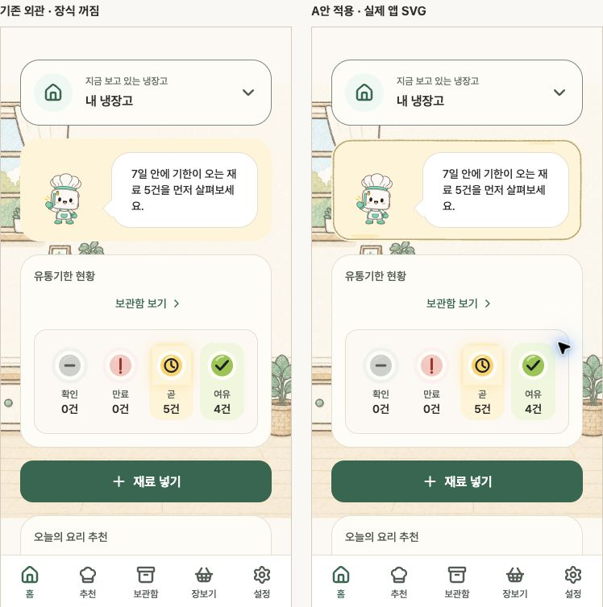

# 홈 안내 카드 크레파스 A안 앱 적용

> **2026-10-14 철회:** 홈 카드의 크레파스 윤곽·색칠을 제거하고 일반 테두리를 복원했다.
> 캐릭터·배경 이미지와 당시 승인·캡처·manifest 해시는 보존한다. 아래는 `c057084`의
> 구현 이력이며 현행 컴포넌트 계약이 아니다. 현재 소스를 이용한 과거 장식 비교는 종료했다.

2026-10-14 종료된 component-check·HTML·preview 실행 파일을 제거했다. 아래 캡처·manifest와
당시 승인·검사 기록은 보존하며 [삭제 경로와 해시](../../jango/quality/cleanup-resources-20261014.json)를 남겼다.

2026-10-09 사용자의 실제 앱 적용 요청에 따라 선택한 A안을 홈 안내 한 곳에 연결했다.
[A안·상태색 보완 기록](../home-card-crayon-point-v1/README.md)을 구현 기준으로 사용했다.
기존 탭·정보 순서·카드 크기·패딩·장고·말풍선·상태색 면·기능 배치를 유지한다.
소스·캡처 해시와 비교 조건은 [manifest.json](./manifest.json)에 기록한다.

## 구현 범위

- [SurfaceCard](../../../apps/mobile/src/components/SurfaceCard.tsx)의 `decoration="crayon"`은
  기본 꺼짐이고 `hero`에만 적용한다. [HomeHero](../../../apps/mobile/src/features/home/home-hero.tsx)
  한 곳에서 켰다. 인사이트 6곳과 일반·inline 카드는 기존 외관을 유지한다.
- 당시 공유 장식 토큰 `decoration.ts`는 색·선 굵기·불투명도·
  grain을 관리한다. 기존 기능 토큰 값과 Admin CSS 변수는 변경하지 않았다.
- 당시 `CrayonCardDecoration`은 실제
  카드 안쪽 크기로 `crayon-card-geometry.ts`의 정적인 경로를
  계산한다. 전체 프레임을 확대하지 않아 선 굵기·모서리가 늘어나지 않는다.
- 윤곽·작은 획은 실제 카드 tone의 민트·앰버·코랄 계열을 함께 따른다. 렌더마다 난수를
  생성하지 않으며 SVG pattern/mask는 카드마다 고유 ID를 사용한다.
- 장식은 절대 위치의 별도 레이어다. 터치를 통과시키고 iOS `accessibilityElementsHidden`,
  Android `no-hide-descendants`로 화면 읽기에서 제외한다. 큰 글자에서는 작은 색칠을 생략한다.
- 코드형 SVG만 추가했다. 새 PNG·질감 필터·캐릭터 생성·MASTER 편집·runtime 에셋 교체가
  없어 이미지 sync·audit 경로 추가는 해당 없다. 원화 제작 절차를 실행할 변경도 없다.

## 전후 비교와 검증

최소 전후 비교 자료는 위 [임박](./screens/app-comparison-360-warning.jpg)과
[일반](./screens/app-comparison-360-calm.jpg), [기한 경고](./screens/app-comparison-360-expired.jpg),
[폭 320·글자 2배](./screens/app-comparison-320-large-text.jpg) 네 장이다. Chrome CUA에서
두 화면과 비교 제목 영역을 `clip`으로 촬영했고 이후 이동·크롭·리터칭하지 않았다.
활성 탭에서 글꼴·이미지 로딩 완료를 확인해 촬영했다. 과도한 임시·중복 캡처는 정리했다.

- 실제 `HomeScreen`·`HomeHero`·`SurfaceCard`·SVG 컴포넌트를 React Native Web으로 렌더링한다.
  기준 화면은 메모리 번들에서 홈 장식 옵션만 끈 것이다. 제품 소스의 장식은 켜져 있다.
  예시 데이터·정지 모션·고정 safe area·글자 배율·검토용 탭 어댑터는 이전 시안과 같다.
  API·영속 Query 서비스가 번들에 포함되면 빌드를 중단한다.
- 일반·기한 경고·임박·첫 재료·오류·처리 중·완료·로딩과 폭 320/360/768·글자 1/1.3/2의
  대표 16개 조건에서 카드·글자·이미지·접근성 이름·상태색 면·스크롤 길이가 전후 일치했다.
  큰 글자에서는 작은 색칠이 없으며 로딩에는 카드와 SVG가 없다.
- 검토용 카드 페이지에서 버튼을 눌러 `primary → warning → danger → primary`로 바꿨다.
  같은 SVG mask ID와 카드 크기를 유지하면서 색이 바뀌었다. 버튼이 반응했고 기본 꺼짐
  카드에는 SVG가 없었다. 두 장식 카드의 mask ID가 서로 달랐고 다른 카드의 색은 유지됐다.
- 공유 토큰 계약·잘못된 측정값·좁은 카드·고정 경로 경계·홈 상태 관련 테스트를 실행했다.
  `pnpm lint`, `pnpm typecheck`, `pnpm test`가 통과했다. 전체 1,284개 통과, API 6개 생략이다.
- 첫 root 검사의 캐릭터 검수 테스트는 공유 `unregistered-test.png` 관련 2개 실패가 있었다.
  해당 임시 파일을 만드는 테스트의 동시 실행 충돌로 추정한다. 검수 기준이나 테스트를
  수정하지 않고 단독 및 전체 재실행에서 통과했다.
- dotenv 로딩과 외부 업로드를 끈 development 환경에서 Android와 iOS의 Expo/Hermes
  모바일 번들을 저장소 밖 임시 폴더로 생성해 모두 통과했다. APK/IPA 배포를 수행하지 않았다.

브라우저 확인과 모바일 번들 생성은 실제 기기 검증을 대신하지 않는다. 로컬에 사용 가능한
iOS 기기 정의는 있었으나 Simulator 실행 앱을 열 수 없었고 활성 네이티브 검토 앱도 없었다.
실제 기기의 전후 캡처·VoiceOver/TalkBack·캐러셀 넘김·가로·네이티브 스크롤 끝 접근·
동작 줄이기·전체 반응형 QA와 출시 검증은 미실시다. 스타일 시안과 현재 소스 기반 비교를
기기 캡처로 표시하지 않는다. 의도한 모바일 시각 변경의 PR에는 전후 자료와 이유를 남기고
`approve-mobile-layout-change` 검토 절차를 따른다. 회귀 기준을 우회하거나 갱신하지 않았다.

## 과거 검토의 재현

현재 소스 기반 장식 비교 서버는 종료했다. 당시 화면과 승인·측정·출처 해시는 이 폴더의
보존 자료에서 확인한다. 코드 재현이 필요하면 `c057084`의 저장소 스냅샷과 당시 기록을
사용한다. 과거 시안·검사 결과를 현재 UI나 출시 검증으로 표시하지 않는다.
