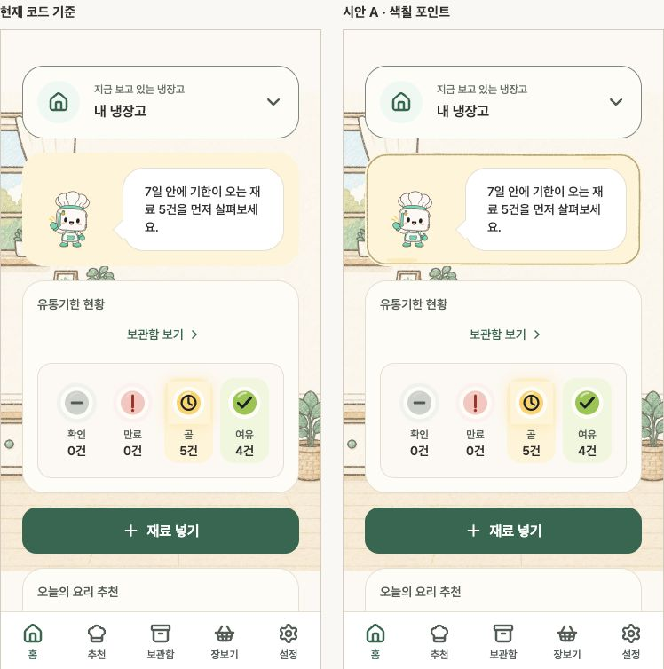

# 홈 안내 카드 크레파스 포인트 시안

> **2026-10-14 철회:** 캐릭터·배경 이미지의 그림체는 유지하고 UI 손그림 장식·확대 계획은
> 종료했다. 아래 승인·시안·manifest 해시는 당시 이력으로 보존한다. 현재 소스에서 과거
> 전후 비교를 재생하지 않으며, 당시 코드가 필요하면 `c057084`의 저장소 스냅샷을 사용한다.

이 문서는 앱 적용 전 revision 1·2의 선택 근거를 보존한 기록이다. 이후 사용자가 실제 앱
적용을 요청해 [앱 적용·검증 기록](../home-card-crayon-implementation-v1/README.md)으로 진행했다.
아래 미적용 표현과 소스 해시는 당시 스냅샷이며 현행 앱 상태와 구분한다. 공용 검토 harness는
앱 구현 비교에도 사용하므로 현재 파일 해시와 당시 해시가 다를 수 있다.

2026-10-09 작성. [철회된 계획안](../../../docs/archive/mobile-crayon-point-plan.md)의 대표 시안 단계다.
현재 모바일 소스로 기준 화면과 A/B안을 함께 렌더링한다. 사용자가 A안 방향을 선택했고,
상태 배경색에 맞춘 색 보완안을 추가했다. 제품 앱에는 아직 적용하지 않았다.
보존 요소·치수 비교·출처 해시는 [manifest.json](./manifest.json)에 기록한다.

## 비교와 권장안

| 안 | 표현 | 검토 의견 |
|---|---|---|
| 현재 코드 기준 | 기존 상태색 면과 외곽선 | 같은 소스·예시 데이터·화면 폭·글자 배율의 비교 기준 |
| A · 색칠 포인트 | 단일 손그림 윤곽, 고정된 미세한 선 결, 상태색 계열의 작은 획 | 사용자가 선택한 표현 방향. 배경의 손그림 선과 연결되면서 안내 면은 깨끗하게 유지 |
| B · 은은한 윤곽 | A보다 가늘고 연한 윤곽, 색칠 없음 | 장식 강도를 더 낮추고 싶을 때 비교할 대안 |

사용자는 “A 시안이 마음에 드는데 상태에 따라 배경색에 맞게 색을 바꿔야할 필요성도 보이네”라고
요청했다. A안의 표현 방향을 선택한 것으로 기록하고, 이번 색 보완안을 따로 검토한다.
별·축하 기호, 손글씨 교체, 크레파스 말풍선, 카드 확대, 다른 섹션의 장식은 이 후보에 넣지 않았다.
글자 배율 1.3 이상에서는 A의 작은 색칠도 생략한다. 기존 상태색 면과 기능 아이콘을 유지한다.

## 상태 배경색에 맞춘 보완안 · revision 2

| 실제 카드 tone | 현재 홈 상태 | 윤곽 역할 | 작은 색칠 역할 |
|---|---|---|---|
| `primary` · 민트 | 일반·첫 재료·추천 처리 중·추천 완료 | `primaryForeground` | `brandAccent` |
| `warning` · 앰버 | 임박 안내 | `warningForeground` | `warningAccent` |
| `danger` · 코랄 | 기한 경고·불러오기 오류 | `dangerForeground` | `dangerAccent` |

검토 번들에서 실제 `SurfaceCard`의 `tone`을 읽어 윤곽과 색칠을 함께 선택한다. 합성 상태명,
배경 RGB 추정, 장고 mood로 색을 다시 결정하지 않는다. 로딩에는 현행 코드대로 카드가 없고,
표에 없는 tone은 중립 윤곽만 사용한다. 기존 면·선 굵기·장식 밀도·불투명도는 유지한다.
제품 구현에서는 위 역할을 별도 공유 장식 토큰으로 분리하고 기존 기능 토큰 값은 보존한다.

최신 최소 비교 자료는 위 [임박 안내](./screens/tone-360-warning-detail.jpg)와
[일반 안내](./screens/tone-360-primary.jpg), [기한 경고](./screens/tone-360-danger.jpg) 세 장이다.
초기 선택 근거인 [revision 1 A안](./screens/comparison-360.jpg)과 [B안](./screens/comparison-360-light.jpg),
[기한 경고](./screens/comparison-360-expired.jpg),
[폭 320·글자 2배](./screens/comparison-320-large-text.jpg)는 제작 이력으로 보존한다.
초기 네 장과 일반·기한 경고는 브라우저 전체 캡처다. 최신 임박 안내는 브라우저의 `clip`
옵션으로 두 화면과 비교 제목 영역만 촬영했다. 캡처 이후 이동·크롭·리터칭하지 않았다.

## 검토 결과와 한계

- 일반·기한 경고·임박·첫 재료·오류·추천 처리 중·추천 완료·로딩의 A안을 비교했다.
  로딩에는 현재 소스대로 안내 카드와 장식이 없다.
- 대표 반응형 조합은 폭 320의 글자 1/2배, 폭 360의 1/1.3배, 폭 768의 1.3/2배다.
  B안은 폭 360·일반 안내·기본 글자를 비교했다.
- 색 보완안은 기존 14개 조합에 폭 320·글자 2배의 임박·기한 경고를 추가한 16개 조건에서
  비교했다. 카드·글자·이미지·기존 접근성 이름의 영역, 상태색 면, 스크롤 컨테이너의
  길이를 소수점 둘째 자리까지 비교했으며 전후가 같았다. 장식은 `aria-hidden`과
  `pointer-events: none`으로 콘텐츠 검사에서 제외한다.
- 처리 중 상태의 첫 측정은 이미지 준비 상태가 달랐으며 렌더가 완료된 접근성 상태를
  확보한 뒤 다시 비교해 일치했다. 색이 달라져도 글자 확대 시 작은 색칠을 생략한다.
- 폭 320·글자 2배에서는 기존 안내가 길어져 카드 높이가 388 CSS px다. 시안도 같은 높이를
  유지한다. 필수 안내를 줄이거나 장식 여백 때문에 높이를 늘리지 않았다.
- `SurfaceCard` 호출은 홈 안내 1곳과 인사이트 6곳이다. 이후 선택적 장식을 구현할 때
  홈에만 켜고 인사이트 6곳을 미사용 회귀 대상으로 확인한다. `borderControl`, `borderSubtle`,
  `surfaceWarm`은 입력·목록·다른 화면에도 쓰이므로 기존 값을 바꾸지 않는다.

이 자료는 **React Native Web을 통한 소스 기반 표현 검토**다. 기준은 현재 `HomeScreen`,
`HomeHero`, `SurfaceCard`, 말풍선·재고 신호 등 실제 컴포넌트이며 다음 어댑터를 사용한다.

- 서버 상태·공간·계정·추천 상태는 합성 fixture다. 실제 API·저장·분석 이벤트를 연결하지 않는다.
  API와 영속 Query 서비스가 번들에 포함되면 빌드를 중단한다.
- Safe area 상단은 검토용 고정값이고, Reanimated는 최종 정지 상태로 표현한다.
  아래 5개 탭은 기존 순서·아이콘·반응형 글자 기준의 검토용 표시다. 실제 navigator가 아니다.
- Pretendard 원본 폰트를 사용한다. 브라우저 Text 어댑터가 기존 `maxFontSizeMultiplier`와
  선택 배율을 반영하지만 iOS/Android의 네이티브 글자 배율과 줄바꿈을 보증하지 않는다.
- 장고는 기존 `Mascot`의 에셋을 그대로 읽는다. 캐릭터 PNG를 새로 생성·편집·교체하지 않았다.
  대표 24번과 MASTER 목록은 스타일 출처이며 검토 화면의 mood 선택은 현행 코드가 결정한다.
- `SurfaceCard`의 검사 ID와 실제 tone의 DOM 속성을 메모리 안의 번들에만 추가한다.
  크기와 tone 변경을 관찰해 검토용 장식을 갱신한다. 제품 소스와 공유 토큰은 수정하지 않았다.

실제 기기의 기준·후보 캡처, VoiceOver/TalkBack·키보드 초점·터치·캐러셀 넘김·탭 이동·
입력·가로 화면·동작 줄이기·네이티브 스크롤 끝 접근은 아직 검증하지 않았다. 현재 홈 소스는
검토한 각 상태에서 소식 1개를 반환하므로 다중 소식 캐러셀 상태도 별도 검증해야 한다.
과거 홈 배경·말풍선 시안 캡처는 현재 네이티브 검증 자료로 사용하지 않는다.

자동 검증은 검토 번들 빌드와 `pnpm docs:check`, `pnpm lint`, `pnpm typecheck`, `pnpm test`를
통과했다. 최종 테스트는 1,280개 통과, API 6개 생략이다. 검사 중 캐릭터 지침과 보고서가
함께 갱신돼 초기 검사에 stale report 실패가 있었고 갱신된 기준으로 재검사했다.
해당 정본·보고서 갱신은 홈 카드 시안 변경에 포함하지 않는다.

## 과거 검토의 재현

현재 소스 기반 장식 비교 서버는 종료했다. 당시 화면과 승인·측정·출처 해시는 이 폴더의
보존 자료에서 확인한다. 코드 재현이 필요하면 `c057084`의 저장소 스냅샷과 당시 기록을
사용한다. 과거 시안·검사 결과를 현재 UI나 출시 검증으로 표시하지 않는다.
